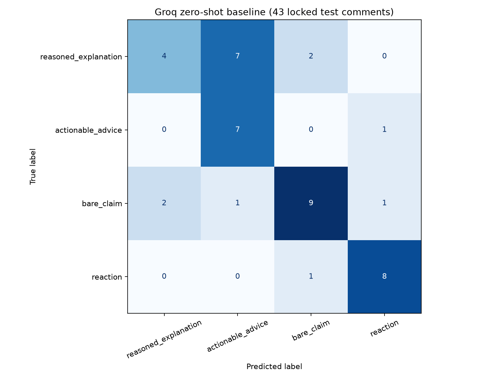
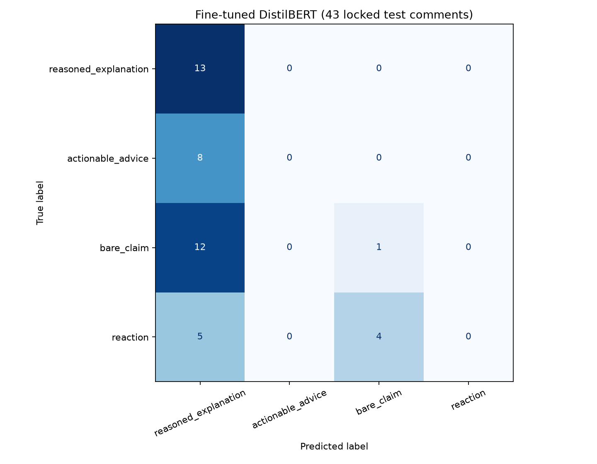
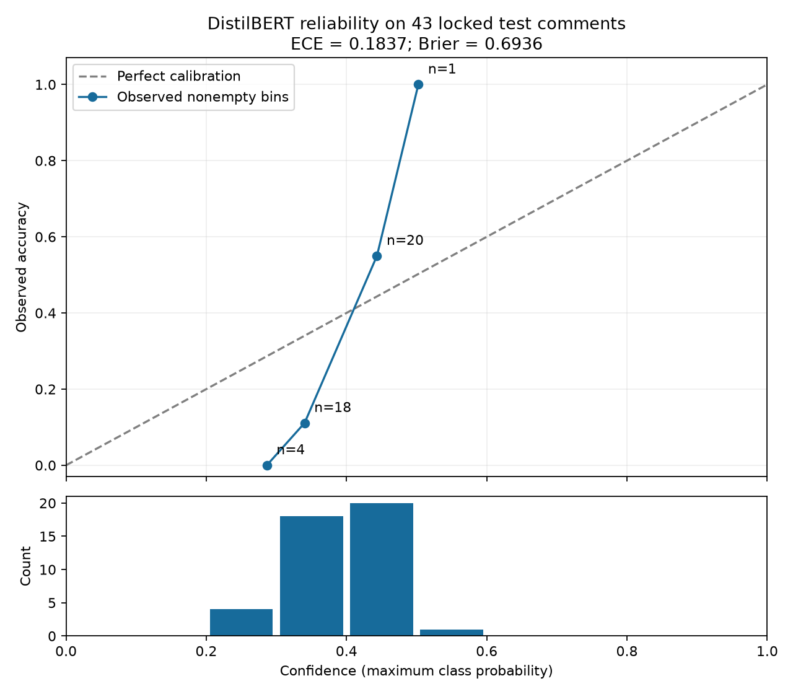

# TakeMeter

**Classifying the contribution a public r/3Dprinting comment makes—not whether its technical advice is correct.** CodePath AI201 / CSCI 485 Project 3.

TakeMeter distinguishes reasoning, concrete advice, unsupported claims, and social reactions. The final corpus contains **282 real, personally reviewed comments**. On the same locked 43-comment test set, the authorized Groq zero-shot baseline achieved **65.12% accuracy / 0.6480 macro-F1**, while fine-tuned DistilBERT achieved **32.56% / 0.1552**. Fine-tuning did not meet the pre-registered success criteria. This repository preserves that outcome rather than tuning against the test set.

The local classifier, calibration analysis, error analysis, and non-demo documentation are implemented. **Demo video: To be recorded after final repository audit.** No hosted app or recorded demo is claimed.

## Community and taxonomy

r/3Dprinting combines troubleshooting, materials, orientation, settings, design critique, and social discussion. The same subject can prompt a causal explanation, a terse instruction, a diagnosis, or encouragement. This connects to the student's Mechanical Engineering and additive-manufacturing interests. The unit of analysis is one comment, not a whole thread.

The authoritative definitions and decision rules are in [planning.md](planning.md), originally committed before collection. Its dated final section is a later stretch plan; the original taxonomy remains unchanged.

| Label | Definition |
|---|---|
| `reasoned_explanation` | Meaningfully supports a conclusion, diagnosis, recommendation, or viewpoint with causal reasoning, observable evidence, a technical principle, an explicit tradeoff, or experience explaining why the conclusion follows. Naming a problem or adding a short description is insufficient. |
| `actionable_advice` | Provides a concrete recommendation, procedure, setting change, resource, or next step without substantial reasoning for why it should work. |
| `bare_claim` | States an answer, diagnosis, opinion, preference, or conclusion without substantial support or sufficiently concrete actionable guidance. |
| `reaction` | Primarily social or emotional: humor, agreement, appreciation, encouragement, surprise, dismissal, or a similar response that does not materially advance technical discussion. |

Advice plus meaningful explanation is `reasoned_explanation`; advice with little rationale stays `actionable_advice`. A diagnosis without a next step is `bare_claim`. Experience counts as reasoning only when it explains **why** a conclusion follows. Planning contains two examples per class and explicit boundary examples. Pure information-seeking questions were outside the intended sampling frame.

## Collection, annotation, and difficult cases

The initial collection used the Arctic Shift public Reddit archive across nine topic queries: 900 retrieved comments, 364 removed by deterministic filters (including 70 duplicate IDs/texts), 536 eligible, and 400 retained across 190 threads. Filters addressed boilerplate, clear questions, duplicates, and a thread cap. URLs, comment/thread IDs, text, and retrieval metadata were preserved; author identities were not collected.

When reaction candidates were exhausted, 60 public comments from eight showcase/humor-oriented threads were added using Wayback snapshots after archive-server errors and blocked Reddit JSON access. They were deduplicated against the existing pool and each other. The combined pool is 460 comments; the final accepted set is 282 across 130 threads, with 178 remaining unreviewed—not automatically rejected. The supplemental process targeted contexts, not forced reaction labels. Details: [initial collection](data/collection_summary.json), [supplemental collection](data/supplemental_collection_summary.json).

| Final label | Count | Share | Train | Validation | Test |
|---|---:|---:|---:|---:|---:|
| reasoned_explanation | 89 | 31.56% | 63 | 13 | 13 |
| actionable_advice | 50 | 17.73% | 34 | 8 | 8 |
| bare_claim | 83 | 29.43% | 58 | 12 | 13 |
| reaction | 60 | 21.28% | 42 | 9 | 9 |
| **Total** | **282** | **100%** | **197** | **42** | **43** |

AI pre-labels were suggestions. The initial 400 candidates received 259 successful proposals from `openai/gpt-oss-20b`, then 141 from `qwen/qwen3.8-27b` after an observed token limit. The 60 supplemental candidates were also pre-labeled with `qwen/qwen3.8-27b` (48 reaction, 8 bare claim, 4 advice proposals). Run summaries are retained; the working CSV does not identify the annotation model per row, so final-set counts cannot be attributed reliably to each model.

The student personally reviewed every accepted example. Initially all 282 accepted labels matched the AI proposals, with no difficult cases flagged. A deliberate **post-annotation boundary audit** then surfaced ten real examples, identified three genuine difficult cases, and prompted two authorized corrections. Final AI-to-human agreement is **280/282 = 99.29%**, with two corrections. This documents annotation assistance; it is **not inter-annotator reliability**. There was no second human annotator.

**[pc78qi3](https://www.reddit.com/r/3Dprinting/comments/1wl3o4h/tips_wanted_making_this_object_solid_bandsaw_vise/pc78qi3/)**

> Filament is cheap. Make it like 20 walls.

Decision: `reasoned_explanation` ? `actionable_advice`. Competing boundary: `actionable_advice`. The recommendation to use approximately 20 walls is concrete advice; the cost justification does not meaningfully explain why 20 walls is technically appropriate.

**[pc23bto](https://www.reddit.com/r/3Dprinting/comments/1wq3o4k/paper_vs_feeler_gauge_for_bed_leveling_what_do/pc23bto/)**

> I calibrate the paper I use with a feeler gauge, if that helps.

Decision: `actionable_advice` ? `actionable_advice`. Competing boundary: `bare_claim`. Though phrased as personal practice, it pragmatically offers a specific procedure without substantial explanation of why it works.

**[pc7vzug](https://www.reddit.com/r/3Dprinting/comments/1wqrl4p/wip_hotend_station/pc7vzug/)**

> that is very unnecessary lol. i also print technical filaments (just about everything you can think of) and i've never had to do this. never had a clog on a bambu machine. you should get checked for OCD fasho

Decision: `reaction` ? `bare_claim`. Competing boundary: `bare_claim`. Despite its dismissive tone, its substantive contribution is an experience-backed claim that the procedure is unnecessary, without a technical mechanism or concrete alternative action.

These cases were identified after initial annotation, not retrospectively presented as original flags. The exact decisions and rationale are in [difficult_cases.json](data/difficult_cases.json). Finalization preserves human review state and exports [labeled_posts.csv](data/labeled_posts.csv); provenance remains in [annotation_working.csv](data/annotation_working.csv). [ANNOTATION_GUIDE.md](ANNOTATION_GUIDE.md) documents the separate review workflow.

## Locked experiment and baseline

The fixed seed-42 stratified split is approximately 70/15/15 (197/42/43). [split_assignments.csv](data/split_assignments.csv) is the authoritative comment-ID mapping. Scripts join stable IDs from the reviewed metadata to the matching final CSV and load this mapping; they do not generate a replacement split. Both models use identical test IDs. Training uses only train rows, checkpoint selection uses only validation rows, and test labels never enter baseline prompts.

The assignment-prescribed `meta-llama/llama-4-scout-17b-16e-instruct` was actually attempted first and returned **HTTP 404 / model_not_found**. [Sanitized failure evidence](artifacts/prescribed_baseline_failure.json) is preserved. The student then explicitly authorized **`openai/gpt-oss-20b`** as the substitute. This is not a Scout baseline result.

The substitute used the unchanged [zero-shot template](artifacts/baseline_prompt_template.txt), finalized definitions/rules, one comment, temperature 0, and exact-label parsing. It contained no labeled demonstrations, training/validation examples, or answer labels. All **43 predictions parsed successfully**. Rate-limit retries preserved the request; no correctness-driven prompt tuning occurred. Actual response IDs/content and prompt hashes are in [baseline_requests.jsonl](artifacts/baseline_requests.jsonl).

## Fine-tuning method

`distilbert-base-uncased`, revision `12040accade4e8a0f71eabdb258fecc2e7e948be`, was fine-tuned locally on an NVIDIA RTX 4070 (`cuda:0`, PyTorch `2.14.0+cu130`, Transformers `5.17.0`). The assignment defaults were **3 epochs, learning rate 2e-5, batch size 16, seed 42**. AdamW used zero weight decay, gradient norm clipping at 1, float32, and a linear learning-rate decay over **39 optimization steps** with no warmup.

The maximum length **256** was fixed before test inference using the train+validation 95th percentile rounded up to 64, bounded to 128–512. It truncated 10 training and 1 validation comments. Epoch 3 had the lowest validation cross-entropy and was selected. The selected model was evaluated exactly once on the locked test set; later interface smoke tests use newly authored inputs, not another test evaluation.

| Epoch | Train loss | Validation loss |
|---|---:|---:|
| 1 | 1.3623 | 1.3291 |
| 2 | 1.2835 | 1.2966 |
| 3 | 1.2327 | 1.2820 |

Selected validation accuracy was **33.33%**, macro-F1 **0.1617**. Measured training-loop runtime was **5.76 seconds**, total including loading/downloads **19.28 seconds**. Decreasing loss demonstrates optimization progress, not successful separation of the intended categories. See [training configuration](artifacts/training_config.json) and [observed history](artifacts/training_results.json).

## Results and comparison

| Model | Correct / test count | Accuracy | Macro-F1 |
|---|---:|---:|---:|
| Authorized Groq zero-shot substitute | 28/43 | **65.12%** | **0.6480** |
| Fine-tuned DistilBERT | 14/43 | **32.56%** | **0.1552** |

DistilBERT is lower by **32.56 percentage points** of accuracy and **0.4927** macro-F1. The zero-shot baseline substantially outperformed this fine-tuning run; this is not a fine-tuning success claim.

| Label | Baseline precision | Recall | F1 | DistilBERT precision | Recall | F1 |
|---|---:|---:|---:|---:|---:|---:|
| reasoned_explanation | .667 | .308 | .421 | .342 | 1.000 | .510 |
| actionable_advice | .467 | .875 | .609 | .000 | .000 | .000 |
| bare_claim | .750 | .692 | .720 | .200 | .077 | .111 |
| reaction | .800 | .889 | .842 | .000 | .000 | .000 |

Class IDs and both matrix axes use this order: reasoned_explanation, actionable_advice, bare_claim, reaction. Rows are true labels; columns are predictions.

```text
Baseline                 DistilBERT
[4, 7, 2, 0]             [13, 0, 0, 0]
[0, 7, 0, 1]             [ 8, 0, 0, 0]
[2, 1, 9, 1]             [12, 0, 1, 0]
[0, 0, 1, 8]             [ 5, 0, 4, 0]
```




The baseline got 4 of 13 explanations right, predicting 7 as advice and 2 as bare claims. This corresponds to the explanation/advice boundary anticipated during planning; it is an observed correspondence, not causal proof. DistilBERT predicted explanation **38/43 times (88.37%)**, bare claim five times, and neither advice nor reaction. Its errors were 12 claims→explanations, 8 advice→explanations, 5 reactions→explanations, and 4 reactions→claims.

All three pre-registered success thresholds were **not met**: accuracy ≥70%, macro-F1 ≥0.65, and every class F1 ≥0.50. The minimum class F1 was zero. Metrics: [baseline](artifacts/baseline_results.json), [fine-tuned](artifacts/finetuned_results.json), [comparison](artifacts/model_comparison.json). Every prediction is retained in the corresponding `*_predictions.csv`.

## Actual mistakes and systematic analysis

The following are actual fine-tuned errors, not invented demonstrations. Their interpretations were AI-assisted and checked against saved text, predictions, and taxonomy; they are not claimed as independently discovered or newly verified by the student.

**[pbz923l](https://www.reddit.com/r/3Dprinting/comments/1wncbyx/test_prints_perfect_but_my_own_files_print_like/pbz923l/)** ? true `actionable_advice`, predicted `reasoned_explanation`, confidence **46.54%**.

> Typically I do it while it's printing the first layer. So select something with a big solid first layer then adjust z offset as it prints.

Probabilities: reasoned_explanation: 0.4654, actionable_advice: 0.1748, bare_claim: 0.2188, reaction: 0.1410.

The comment supplies a procedure: adjust z offset during a large first layer. It does not develop why the adjustment solves a problem. Mistaking a multi-step technical procedure for supported reasoning is consistent with this error, but no causal feature attribution was performed.

**[pc1nuul](https://www.reddit.com/r/3Dprinting/comments/1wq4xmx/using_magnets_as_spring_is_such_a_satisfying/pc1nuul/)** ? true `bare_claim`, predicted `reasoned_explanation`, confidence **30.28%**.

> That is the proper TP orientation...

Probabilities: reasoned_explanation: 0.3028, actionable_advice: 0.2110, bare_claim: 0.2647, reaction: 0.2215.

The brief orientation assertion supplies neither a mechanism nor a concrete next step. Predicting an explanation for this six-word claim shows that the dominant class extends to short unsupported assertions; technical vocabulary or length alone cannot establish the cause.

**[gyxhfex](https://www.reddit.com/r/3Dprinting/comments/nhp6b5/my_first_3d_print_so_proud_of_myself/gyxhfex/)** ? true `reaction`, predicted `bare_claim`, confidence **27.31%**.

> Thought of Mongolia 😄

Probabilities: reasoned_explanation: 0.2586, actionable_advice: 0.2137, bare_claim: 0.2731, reaction: 0.2546.

The Mongolia association and smiling emoji express a social reaction rather than a technical claim. Its bare_claim prediction illustrates a missed social function. This interpretation follows the text and taxonomy, not a causal explanation of model internals.

The complete [29-error export](artifacts/finetuned_errors.csv) retains exact text, URLs, confidence, and four-class probabilities. [error_analysis.json](artifacts/error_analysis.json) and [error_analysis.csv](artifacts/error_analysis.csv) reproduce broader diagnostics:

- The baseline predicted 6 explanations, 15 advice, 12 claims, and 10 reactions; DistilBERT predicted 38, 0, 5, and 0. Predictions agreed on **7/43** cases and disagreed on 36.
- Both models were correct on 5 cases; only the baseline on **23**; only DistilBERT on **9**; both were wrong on 6. IDs and all prediction pairs are preserved in the analysis artifact.
- Mean test lengths (whitespace words) were 80.46 for explanations, 70.00 for advice, 44.85 for claims, and 26.11 for reactions. Correct fine-tuned predictions averaged **79.00 words**, errors **45.45**. This association is confounded by true class and the dominant predicted class; it does not prove a learned length rule.
- Mean confidence was **43.58% on correct predictions** and **36.34% on errors**. The highest-confidence error was `pbzqybs`, advice→explanation at **49.63%**. “Highest” is relative: none of the errors exceeded 50% confidence. The five highest are exported with text and provenance.
- A declared printing-term lexicon occurred in 32 test comments; 28 were predicted explanation. Among 11 comments without those terms, 10 were also predicted explanation. The dominant prediction therefore persists without that lexicon. Question marks, newlines, and comments ≤20 words are also measured descriptively, without significance or causal claims.

### Learned behavior versus intended behavior

The intended skill is discourse-function discrimination, especially whether a recommendation supplies meaningful support. The observed model instead assigns one class across a wide range of functions, including unsupported short assertions and concrete instructions. A broad technical-discourse cue is a plausible hypothesis, but the no-lexicon group and short errors do **not** establish that explanation. No feature attribution or controlled ablation was performed.

The 197-example training set, moderate imbalance (63 explanations versus 34 advice in training), shared topic vocabulary, subtle semantic boundaries, and only 39 optimization steps are relevant limitations or hypotheses. They do not individually explain the collapse. The training and validation losses decreased, while selected validation classification performance remained poor. Reporting the failure is more defensible than using the already-observed test set to find better hyperparameters.

## Confidence calibration analysis

Calibration is **evaluated, not fitted or corrected**. Confidence is the maximum saved class probability. Ten equal-width bins use `[lower, upper)` boundaries, with 1 included in the last bin. Empty bins contribute zero to ECE and have null mean/accuracy. ECE is the count-weighted absolute gap between bin accuracy and mean confidence. The multiclass Brier score averages the **sum** of four squared errors per example; it is not divided by four.

Observed **ECE: 0.1837**; **Brier score: 0.6936**. Overall mean confidence is **38.70%**, compared with **32.56%** accuracy (6.14 points higher). The 0.3–0.4 bin contains 18 cases, mean confidence 34.02%, accuracy 11.11%; the 0.4–0.5 bin contains 20 cases, mean confidence 44.34%, accuracy 55.00%. These show overconfidence and underconfidence in different regions. Only four bins are populated, and the highest contains one case. This small sample cannot establish population calibration, and low confidence alone is not evidence of calibration.



See [calibration_results.json](artifacts/calibration_results.json). No logits, probabilities, labels, or core metrics were changed.

## Stretch features and local interface

Checkpoint A, `c11e86058d9a42693b282231b067da6937fe04b1`, committed and pushed the stretch plan **before** implementation. Implemented features are saved-probability calibration analysis, systematic error analysis, and a separate **local Streamlit classifier**. Inter-annotator reliability was not implemented.

```powershell
.\.venv\Scripts\python.exe -m streamlit run classifier_app.py
```

The app loads the fine-tuned DistilBERT model/tokenizer from `checkpoints/takemeter-distilbert/`, accepts a comment, and classifies on button press. It displays the label, raw confidence, and all four probabilities; it warns about poor measured performance and long-text truncation. CUDA is preferred, with CPU fallback. No Groq call or key is required. Empty input and missing/invalid checkpoints receive explanatory messages. The annotation app is preserved separately as `app.py`.

Actual CPU and CUDA smoke inference was run on newly authored input, and Streamlit interaction tests exercise submission and error handling. These tests demonstrate functioning inference, **not model quality**. Evidence: [classifier_smoke_test.json](artifacts/classifier_smoke_test.json).

## Setup, reproduction, and artifact handling

Use the pinned dependencies in [requirements.txt](requirements.txt) and the Windows/CUDA installation instructions in [SETUP.md](SETUP.md). The measured environment uses Python 3.13.2. The classifier can run on CPU; training scripts require CUDA. The only API secret is `GROQ_API_KEY` for an authorized baseline rerun, stored in ignored `.env`. Do not commit it.

Weights and tokenizer files are local in ignored `checkpoints/takemeter-distilbert/`; download caches are ignored too. They are **not bundled in Git or published at a download URL**. Restore the existing local checkpoint for this result, or reproduce training at the pinned base revision in a disposable workspace using [EXPERIMENTS.md](EXPERIMENTS.md). Preserve the fixed data and split. That guide explains archiving generated run outputs before a separately authorized reproduction; current scripts intentionally refuse to overwrite core experiments or repeat the final test pass. No retraining was performed for these stretch features.

Read-only core verification and reproducible stretch analysis:

```powershell
.\.venv\Scripts\python.exe -m unittest discover -s tests -v
.\.venv\Scripts\python.exe scripts\validate_experiment.py
.\.venv\Scripts\python.exe scripts\analyze_calibration.py
.\.venv\Scripts\python.exe scripts\analyze_errors.py
```

Analysis scripts regenerate only their derived analysis artifacts. Core validation preserves the historical planning snapshot and also verifies the append-only stretch plan. No training or test inference occurs in those analysis commands. `scripts/smoke_classifier.py` separately tests actual local inference on new text.

The [repository audit](artifacts/repository_audit.md) records evidence against the supplied assignment checklist, including limits. Tests cover core split/metric integrity, calibration boundaries, reproducibility, error membership, CPU fallback, missing checkpoints, and actual Streamlit submission.

## AI disclosure, limitations, and reflection

AI helped stress-test the taxonomy with synthetic boundary cases before collection (as reported in the student-provided project history); those examples are not in the dataset. AI pre-labeled real candidates, with every accepted example reviewed personally by the student. The two post-audit corrections and lack of a second annotator are disclosed above. Codex assisted implementation, debugging, analysis suggestions, documentation, and repository auditing. The failure interpretations here are AI-assisted and grounded in actual artifacts, not presented as independent student discoveries. Student interpretation can accompany the demo.

Limits include a small 43-comment test set, non-random human acceptance and targeted supplemental sampling, shared topics and 19 thread IDs shared between train and test in a comment-level split, possible AI-label anchoring, and an annotation model also used as the substitute baseline. High AI-to-human agreement cannot independently establish annotation validity or reliability. Archived public content can become unavailable. Short text may lack parent-thread context. The accepted `gxiw1ug` text, “Where's the model/file from?”, is a possible sampling-frame tension with the planned exclusion of pure questions; its human reaction label is preserved and no post-test relabeling was performed. It is a dataset limitation, not silently repaired evidence.

The main takeaway is that a sound evaluation workflow can reveal an unsuccessful classifier. Meaningful support versus an action or assertion is a subtle target; optimizing a small model for three epochs did not demonstrate that distinction here. The stronger baseline still struggled at the planned reasoning/advice boundary. These findings support honest reporting and better future study design, not a claim that a particular training change would fix the model.

## Demo status

**Demo video: To be recorded after final repository audit.** The remaining student deliverable is a **3–5 minute recording**: introduce the taxonomy and real dataset; show the locked split and transparent baseline substitution; compare the poor fine-tuned result; walk through one real error and the reliability plot; demonstrate local classification and its uncertainty; close with limitations and reflection. No video link exists yet.
